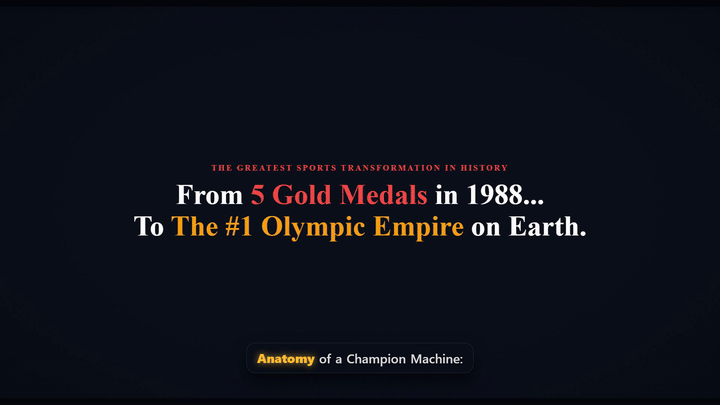

# Anatomy of a Champion Machine: China's Olympic Dominance

[](https://www.remotion.dev/)
[](https://react.dev/)
[](https://www.typescriptlang.org/)
[](https://www.python.org/)
[](https://github.com/thewh1teagle/kokoro-onnx)
[](https://github.com/SYSTRAN/faster-whisper)

A code-driven, programmatic historical video essay and documentary pipeline built with **Remotion (React + TypeScript)** and Python AI audio engineering.

<p align="center">
  
</p>

---

## 📽️ Video Overview

How did a nation once labeled the *"Sick Man of East Asia"*—which won only 5 gold medals and placed 11th at the Seoul 1988 Olympics—transform into a global athletic superpower competing head-to-head with the United States?

This documentary breaks down the institutional machine behind China's sports supremacy:
1. **The "Juguo Tizhi" (Whole-Nation System)**: Scouting 4-year-olds and housing them in 3,000 sports boarding academies.
2. **"Project 119" & The Mathematics of Medals**: Monopolizing 6 core individual sports while deliberately avoiding team sports like soccer.
3. **Sports Science & Aerodynamics**: Repurposing aerospace wind tunnels and high-speed motion capture for millimetric edge.
4. **The Human Cost & Modern Evolution**: The brutal 0.1% pyramid vs. new-generation global icons (Quan Hongchan, Zheng Qinwen).

---

## 📊 Video Specifications

| Metric | Specification |
|---|---|
| **Resolution** | 1920 × 1080 (1080p Full HD, 16:9 Landscape) |
| **Frame Rate** | 30.00 FPS |
| **Duration** | 10,350 frames (~5 minutes 45 seconds) |
| **Master Voiceover** | Kokoro-ONNX `af_heart` (24kHz Neural TTS) |
| **Background Music** | Procedurally synthesized ambient drone in D minor with dynamic DSP ducking |
| **Subtitles** | Word-level kinetic karaoke subtitles with Faster-Whisper alignment |
| **Thumbnail Compositions** | 3 High-CTR variants (`ThumbnailA`, `ThumbnailB`, `ThumbnailC`) |

---

## 🗂️ Project Structure

```
.
├── .gitignore                   # Comprehensive ignores (Node, Remotion, Python, AI models, OS)
├── content.md                   # Source research essay (Indonesian)
├── content_en.md                # Adapted documentary voiceover script (English)
├── generate_voiceover.py        # Kokoro-ONNX batch TTS voiceover & SRT generator
├── package.json                 # Node dependencies and Remotion CLI scripts
├── remotion.config.ts           # Remotion bundler and rendering configuration
├── skills.md                    # Technical capabilities and operator runbook
├── youtube_metadata.md          # YouTube titles, SEO tags, chapters, and description
├── assets/
│   └── teaser.gif               # 5-second 720p animated teaser preview for README
├── scripts/
│   ├── align_subtitles.py       # Faster-Whisper forced word-level timestamp alignment
│   ├── download_assets.py       # Stock image ingestion & CC license audit
│   └── generate_audio_assets.py # NumPy procedural BGM & sound effects generator
├── public/
│   ├── audio/
│   │   ├── bgm.mp3              # Procedural ambient documentary score
│   │   ├── voiceover.mp3        # Master voiceover audio
│   │   └── sfx/                 # Synthesized SFX (impact, whoosh, counter_tick)
│   ├── images/stock/            # Downloaded historical and sports imagery
│   └── subtitles/
│       ├── subtitles.json       # Paragraph-level subtitle segments
│       └── words.json           # Word-level timestamps with startFrame and endFrame
└── src/
    ├── Root.tsx                 # Remotion root registering FullVideo, Scenes 1-6, and Thumbnails
    ├── Composition.tsx          # Master composition with dynamic DSP audio ducking
    ├── scenes.data.ts           # Narrative scene metadata and timeline markers
    ├── assets.manifest.json     # Machine-readable license and attribution ledger
    ├── types.ts                 # TypeScript interfaces for video props and timestamps
    ├── components/
    │   ├── CinematicWrapper.tsx # Aspect ratio letterbox, vignette, and ambient grading
    │   ├── KenBurnsImage.tsx    # Smooth pan/zoom camera motion for archival photography
    │   ├── KineticSubtitle.tsx  # Dynamic word-by-word karaoke typography
    │   ├── SourceCitation.tsx   # Journalistic on-screen source badges
    │   └── Infographics/
    │       ├── CoreSportsGrid.tsx   # 6 core monopoly sports visual matrix
    │       ├── MedalCounter.tsx     # Animated count-up Olympic medal counters
    │       ├── PyramidFunnel.tsx    # Juguo Tizhi talent pyramid funnel
    │       └── TelemetryOverlay.tsx # Biomechanics data graphics & angle brackets
    ├── scenes/                  # Modular narrative scene components (Scene 1 to 6)
    ├── thumbnails/              # High-CTR YouTube thumbnail compositions (A, B, C)
    └── utils/
        └── audioEnvelope.ts     # Precalculated DSP volume ducking envelope
```

---

## ⚡ Quickstart & Installation

### 1. Prerequisites
- **Node.js**: v18 or later
- **Python**: v3.10 or later
- **FFmpeg**: Bundled within `@remotion/compositor-win32-x64-msvc` (or system FFmpeg)

### 2. Install Node Dependencies
```bash
npm install
```

### 3. Install Python Dependencies
```bash
pip install kokoro-onnx faster-whisper soundfile numpy
```

---

## 🔄 End-to-End Production Pipeline

To reproduce or update the documentary from scratch, execute the pipeline in order:

```bash
# 1. Synthesize neural AI voiceover and paragraph SRT
python generate_voiceover.py

# 2. Deploy voiceover to public audio directory
copy voiceover_af_heart.mp3 public\audio\voiceover.mp3

# 3. Extract word-level timestamps with Faster-Whisper
python scripts/align_subtitles.py

# 4. Synthesize procedural ambient score and sound effects
python scripts/generate_audio_assets.py

# 5. Ingest stock imagery and refresh attribution ledger
python scripts/download_assets.py

# 6. Launch interactive Remotion Studio for preview and inspection
npm run dev
```

---

## 🎬 Rendering Commands

### Render Master Video
Render the full documentary to an MP4 container:
```bash
npx remotion render FullVideo out/china_olympic_dominance.mp4
```

To optimize render speed with multi-threading:
```bash
npx remotion render FullVideo out/china_olympic_dominance.mp4 --concurrency=8
```

### Render 5-Second Teaser MP4 & Convert to GIF
Generate a 5-second teaser clip and convert it into a palette-optimized animated GIF for web previews:
```bash
# 1. Render 5-second clip (frames 0 to 149)
npx remotion render FullVideo out/teaser.mp4 --frames=0-149

# 2. Convert to high-quality palette-optimized GIF (15 FPS, 720p width)
& "node_modules/@remotion/compositor-win32-x64-msvc/ffmpeg.exe" -y -i out/teaser.mp4 -r 15 -vf "scale=720:-1:flags=lanczos,split[s0][s1];[s0]palettegen[p];[s1][p]paletteuse" assets/teaser.gif
```

### Render Individual Scenes
Useful for fast visual QA without rendering the full 5-minute composition:
```bash
npx remotion render Scene1 out/scene_1.mp4
npx remotion render Scene2 out/scene_2.mp4
npx remotion render Scene3 out/scene_3.mp4
```

### Render High-CTR Thumbnails
Export single-frame 1080p thumbnail stills:
```bash
npx remotion still ThumbnailA out/thumbnail_option_a.png
npx remotion still ThumbnailB out/thumbnail_option_b.png
npx remotion still ThumbnailC out/thumbnail_option_c.png
```

---

## 🎨 Scene Breakdown

| Scene | Chapter | Timecode | Key Narrative & Visual Focus |
|---|---|---|---|
| **Scene 1** | *The Historical Paradox* | `00:00 - 01:19` | "Sick Man of East Asia", Seoul 1988 crisis, Beijing 2008 & Paris 2024 dominance |
| **Scene 2** | *Juguo Tizhi* | `01:19 - 02:21` | The Whole-Nation System, kindergarten scouting, 3,000 sports boarding schools |
| **Scene 3** | *Project 119* | `02:21 - 03:46` | The 6 core monopoly sports, avoiding team sports, Project 119 breakthrough |
| **Scene 4** | *Sports Science* | `03:46 - 04:13` | High-speed sensor telemetry, aerospace wind tunnels, biomechanical engineering |
| **Scene 5** | *The Human Cost & Modern Era* | `04:13 - 05:08` | The 0.1% pyramid fallout vs. modern expressive stars (Quan Hongchan, Zheng Qinwen) |
| **Scene 6** | *Geopolitics & Outro* | `05:08 - 05:45` | Sports as national legitimacy, credits, and YouTube end screen subscriber cards |

---

## 🚀 YouTube Publishing Package

The repository includes a ready-to-publish YouTube package in [youtube_metadata.md](file:///d:/PROJECTS/yt/hist/4okt26/youtube_metadata.md):
- **3 A/B Title Candidates** tailored for authority, curiosity, and geopolitical angles.
- **Description & Synchronized Timestamps** formatted for YouTube chapters.
- **500-Character SEO Tag Cluster** optimizing search indexing.
- **Asset Attribution Notice** adhering to Creative Commons and Fair Use policies.

---

## 📖 Operational Documentation

For an in-depth technical breakdown of all skills, algorithmic audio DSP calculations, Whisper alignment pointers, and Remotion best practices, refer to [skills.md](file:///d:/PROJECTS/yt/hist/4okt26/skills.md).

---

## 📄 License & Attribution

- **Code & Components**: Licensed under the MIT License.
- **Archival & Stock Media**: Sourced under Creative Commons (CC BY-SA 3.0 / 4.0), Public Domain, or Unsplash Commercial-Free licenses. Full attribution ledger is documented in [src/assets.manifest.json](file:///d:/PROJECTS/yt/hist/4okt26/src/assets.manifest.json).
